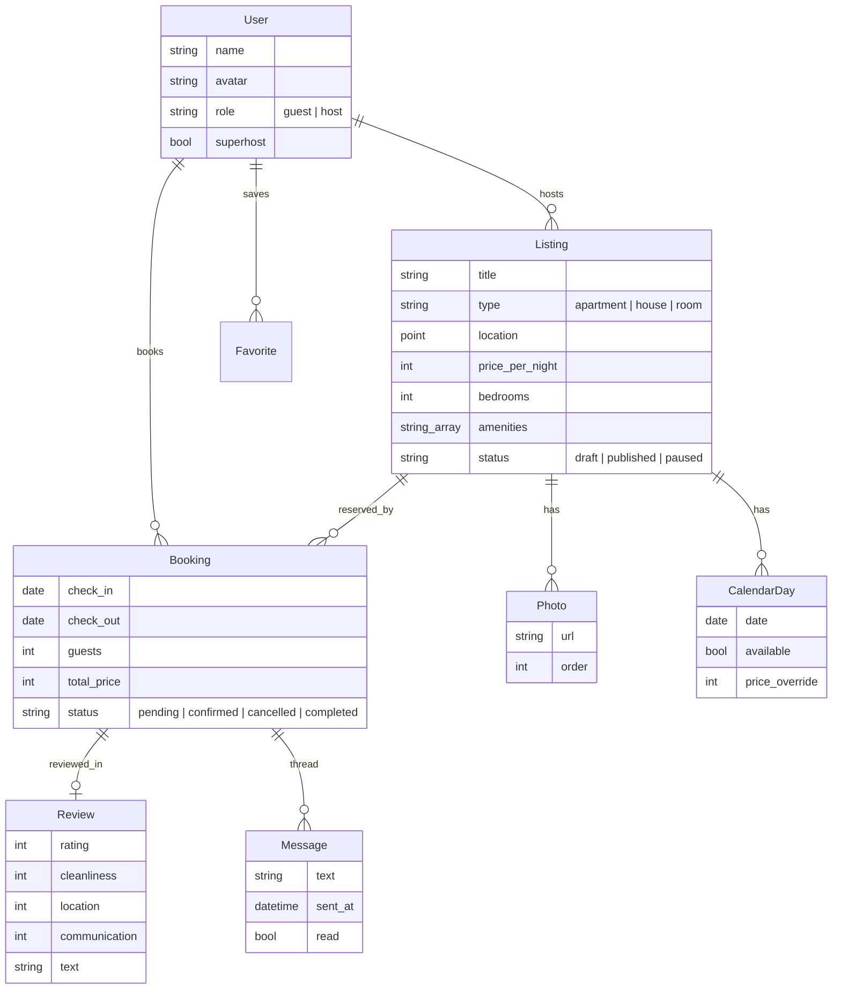

# Practice Angular

Практичні завдання до курсу `Knowledge/Frontend/Angular` (24 теми) + фінальний
проєкт, у якому використовуються всі знання.

## Як працювати з цим файлом

- **Частина 1** — завдання по кожній темі. Майже всі вони будують **один
  навчальний проєкт** — `Filmoteka` (каталог фільмів на реальному
  TMDB API — `developer.themoviedb.org`: пошук, сторінки фільмів і
  акторів, власний список "до перегляду" з оцінками й нотатками). Кожен крок
  спирається на попередній, тож роби їх по порядку.
- Версія — актуальна Angular (19+): **standalone-компоненти** за замовчуванням,
  новий control flow (`@if`, `@for`), **signals**, функція `inject()`. Старі
  підходи (`NgModule`, `*ngIf`, декоратори `@Input`) розбираємо, щоб уміти читати
  існуючий код, але новий код пишемо по-сучасному.
- TypeScript у строгому режимі (`strict: true`, `strictTemplates: true`).
- Ключ TMDB безкоштовний — зареєструйся і поклади його в `environment`.
  Не комить ключ у публічний репозиторій.
- Кожен крок має три рівні:
  - **Основне** — обов'язковий мінімум, щоб закріпити тему.
  - **Ускладнення** — для тих, хто хоче глибше.
  - **Перевір себе** — питання / критерії, за якими зрозуміло, що тема засвоєна.
- **Частина 2** — фінальний проєкт `Stayzy` (фронтенд сервісу короткострокової
  оренди житла: пошук з мапою, бронювання, кабінет господаря): окреме ТЗ,
  етапи, критерії готовності.
- Роби коміт після кожного кроку (`git commit -m "step 12: forms"`) — так
  видно прогрес і легко повернутись назад.
- Не підглядай у готові рішення, поки не спробував сам щонайменше 20-30 хв.
  Підглядай у свої конспекти — для цього вони й писались.

---

# Частина 1. Завдання по темах

## Крок 01. Вступ в Angular: історія, архітектура, CLI, TypeScript basics

Конспект: `[[Вступ в Angular - історія, архітектура, CLI, TypeScript basics]]`

**Основне**
1. Встанови Angular CLI, створи проєкт `ng new filmoteka` (SCSS, без SSR поки
   що), запусти `ng serve`.
2. Розбери кожен файл: `main.ts`, `app.config.ts`, `app.component.ts`,
   `angular.json`, `tsconfig.json`. Запиши в `NOTES.md`, що робить кожен.
3. Опиши TypeScript-типи для даних TMDB: `Movie`, `MovieDetails`, `Person`,
   `Paged<T>` (generic для відповідей зі сторінками).
4. Увімкни `strictTemplates` і переконайся, що проєкт збирається.

**Ускладнення**
- Своїми словами (таблицею) порівняй AngularJS і сучасний Angular, а також
  Angular, React і Vue: що "з коробки", а що — сторонні бібліотеки.

**Перевір себе**
- Чому Angular називають фреймворком, а React — бібліотекою? Що відбувається
  між `ng serve` і першим відображенням сторінки в браузері?

## Крок 02. Компоненти: метадані, standalone, encapsulation, change detection, lifecycle

Конспект: `[[Компоненти - метадані, standalone, encapsulation, change detection, lifecycle]]`

**Основне**
1. Компоненти `HeaderComponent`, `MovieCardComponent`, `MovieListComponent`,
   `FooterComponent` через `ng generate component`.
2. `MovieCardComponent` показує постер, назву, рік, рейтинг (поки зі статичних
   даних — масив із 6 фільмів).
3. Порівняй `ViewEncapsulation.Emulated`, `None`, `ShadowDom` на одному
   компоненті — подивись, як змінюється DOM і CSS у DevTools.
4. Додай логування `ngOnInit`, `ngOnChanges`, `ngAfterViewInit`, `ngOnDestroy`
   і поясни порядок викликів.

**Ускладнення**
- Переведи всі компоненти на `ChangeDetectionStrategy.OnPush` і знайди місце,
  де через це перестало оновлюватись відображення. Поясни чому.
- `DestroyRef` замість `ngOnDestroy`.

**Перевір себе**
- Що таке standalone-компонент і що в ньому означає масив `imports`? Коли
  Angular запускає перевірку змін для компонента з `OnPush`?

## Крок 03. Комунікація між компонентами: @Input/@Output, ViewChild, ContentChild

Конспект: `[[Комунікація між компонентами - Input-Output, ViewChild, ContentChild]]`

**Основне**
1. `MovieCardComponent` отримує `movie` через вхідний параметр і генерує подію
   `addToWatchlist`.
2. `MovieListComponent` передає фільми в картки й обробляє подію.
3. Спершу зроби це декораторами `@Input()` / `@Output()`, потім переведи на
   `input.required<Movie>()` і `output<Movie>()`.
4. `@ViewChild` — кнопка "прокрутити вгору", що фокусує поле пошуку в
   `HeaderComponent`.

**Ускладнення**
- `CardComponent` з content projection (`<ng-content select="[card-title]">`) і
  `@ContentChild` для доступу до спроєктованого вмісту.
- Трансформ інпутів: `input(false, { transform: booleanAttribute })`.

**Перевір себе**
- Чим `@ViewChild` відрізняється від `@ContentChild`? Чому `@ViewChild` ще
  `undefined` в `ngOnInit`?

## Крок 04. Синтаксис шаблонів: інтерполяція, template statements, ref vars

Конспект: `[[Синтаксис шаблонів - інтерполяція, template statements, ref vars]]`

**Основне**
1. В `MovieCardComponent`: інтерполяція назви, року з дати (`{{ movie().release_date.slice(0, 4) }}`),
   рейтинг з одним знаком після коми.
2. Поле пошуку з template reference variable `#query` і кнопкою, що передає
   `query.value` в обробник.
3. Обробник `(keyup.enter)` для пошуку з клавіатури.

**Ускладнення**
- `@let` для проміжних значень у шаблоні.
- Знайди 3 вирази, які варто винести з шаблону в `computed` або метод, і
  поясни чому.

**Перевір себе**
- Чому в шаблоні не можна писати присвоєння й `new`? Яка область видимості у
  template reference variable?

## Крок 05. Прив'язка даних: property, attribute, event, two-way binding

Конспект: `[[Прив'язка даних - property, attribute, event, two-way binding]]`

**Основне**
1. Property binding: `[src]` постера з базовим URL зображень TMDB, `[disabled]`
   для кнопки, якщо фільм уже у списку.
2. Attribute binding: `[attr.aria-label]`, `[attr.data-id]`.
3. Class і style binding: `[class.is-top]` для рейтингу ≥ 8, `[style.--rating]`.
4. Two-way binding `[(ngModel)]` для поля пошуку.

**Ускладнення**
- Власний компонент `RatingStarsComponent` з two-way binding через `model()`
  (`[(value)]="rating"`).

**Перевір себе**
- Чим property відрізняється від attribute (підказка: `value` у `<input>`)?
  На що "розгортається" синтаксис `[(x)]`?

## Крок 06. Control Flow: @if, @for, @switch, @defer

Конспект: `[[Control Flow - @if, @for, @switch, @defer]]`

**Основне**
1. `@for` зі списком фільмів, `track movie.id`, `@empty` — "Нічого не знайдено".
2. `@if` / `@else` для стану завантаження й помилки.
3. `@switch` для бейджа статусу у списку: `planned`, `watching`, `watched`.
4. `@defer (on viewport)` для блоку "Схожі фільми" внизу сторінки з
   `@placeholder` і `@loading`.

**Ускладнення**
- Переведи шаблон зі старого синтаксису (`*ngIf`, `*ngFor`, `ngSwitch`) на новий
  через `ng generate @angular/core:control-flow` і порівняй.
- Поміряй у Network, що код `@defer`-блоку справді вантажиться окремим чанком.

**Перевір себе**
- Навіщо `track` і що станеться з DOM без нього при оновленні списку? Які є
  тригери `@defer`?

## Крок 07. Директиви: структурні, атрибутивні, кастомні

Конспект: `[[Директиви - структурні, атрибутивні, кастомні]]`

**Основне**
1. Атрибутивна директива `appImgFallback`: якщо постер не завантажився —
   підставляє заглушку.
2. Директива `appAutofocus` для поля пошуку.
3. Директива `appTooltip` з `@HostListener` (`mouseenter` / `mouseleave`) і
   `@HostBinding` (або `host` у метаданих).

**Ускладнення**
- Власна структурна директива `*appIfLoggedIn` з `TemplateRef` і
  `ViewContainerRef`.
- Host directives: компонент `MovieCardComponent` отримує `appTooltip` через
  `hostDirectives`.

**Перевір себе**
- Чим структурна директива відрізняється від атрибутивної? Що насправді означає
  `*` перед назвою директиви?

## Крок 08. Pipes: вбудовані, кастомні, precedence, change detection

Конспект: `[[Pipes - вбудовані, кастомні, precedence, change detection]]`

**Основне**
1. Вбудовані: `date` для дати релізу, `currency` для бюджету фільму,
   `number` для рейтингу, `slice` для опису.
2. Власний pipe `runtime`: `142` → `2 год 22 хв`.
3. Власний pipe `tmdbImage`: шлях + розмір → повний URL зображення.

**Ускладнення**
- Impure pipe `relativeTime` ("3 дні тому") — і чому краще зробити його pure з
  передачею поточного часу параметром.
- Розберись з пріоритетом: `{{ a ?? b | uppercase }}` — що застосовується
  першим?

**Перевір себе**
- Чим pure pipe відрізняється від impure з погляду change detection? Чому
  метод у шаблоні гірший за pure pipe?

## Крок 09. Модулі: NgModule, feature modules, lazy loading

Конспект: `[[Модулі - NgModule, feature modules, lazy loading]]`

**Основне**
1. В окремій гілці створи мінімальний застосунок на `NgModule`: `AppModule`,
   `SharedModule`, feature-модуль `WatchlistModule` з lazy loading.
2. Запиши в `NOTES.md` відповідність: `declarations`, `imports`, `exports`,
   `providers` → як те саме робиться в standalone-світі.
3. У `Filmoteka` згрупуй файли за фічами: `features/movies`,
   `features/people`, `features/watchlist`, `shared/`.

**Ускладнення**
- Перенеси `NgModule`-гілку на standalone автоматично
  (`ng generate @angular/core:standalone`) і подивись, що змінилось.

**Перевір себе**
- Навіщо були потрібні NgModule і чому від них відмовились? Коли ти все ще
  зустрінеш NgModule у реальних проєктах?

## Крок 10. Routing: конфігурація, guards, lazy loading, outlets

Конспект: `[[Routing - конфігурація, guards, lazy loading, outlets]]`

**Основне**
1. Маршрути: `/` (популярне), `/search?q=`, `/movie/:id`, `/person/:id`,
   `/watchlist`, `**` → сторінка 404.
2. `loadComponent` / `loadChildren` для lazy loading кожної фічі.
3. Параметри маршруту через `withComponentInputBinding()` — `id` приходить як
   input компонента.
4. Функціональний guard `authGuard` для `/watchlist` (поки — фейковий логін з
   прапорцем у `localStorage`).

**Ускладнення**
- Resolver, що завантажує фільм до переходу на сторінку.
- Іменований outlet для модального вікна трейлера (`/movie/42(modal:trailer)`).
- `canDeactivate`: попередження, якщо в нотатці до фільму є незбережені зміни.
- `withPreloading(PreloadAllModules)` і власна стратегія preload.

**Перевір себе**
- Чим `routerLink` відрізняється від `href`? У якому порядку виконуються guards і
  resolvers?

## Крок 11. Сервіси та Dependency Injection

Конспект: `[[Сервіси та Dependency Injection]]`

**Основне**
1. `WatchlistService` (`providedIn: "root"`): додати, видалити, змінити статус,
   зберегти в `localStorage`.
2. `inject()` замість ін'єкції через конструктор.
3. `InjectionToken<string>` для `TMDB_API_URL` і `TMDB_IMAGE_URL`, надання в
   `app.config.ts`.

**Ускладнення**
- `StorageService` як абстракція з двома реалізаціями (`localStorage`, in-memory
  для тестів), підміна через `useClass`.
- Сервіс, наданий на рівні компонента (`providers` у компоненті), — покажи, що
  кожен екземпляр компонента отримує свій екземпляр сервісу.

**Перевір себе**
- Як працює ієрархія інжекторів (environment vs element)? Що станеться, якщо
  сервіс з `providedIn: "root"` також додати в `providers` компонента?

## Крок 12. Forms: Reactive, Template-driven, Typed, Dynamic

Конспект: `[[Forms - Reactive, Template-driven, Typed, Dynamic]]`

**Основне**
1. Template-driven форма логіну (`ngModel`, `required`, `email`).
2. Reactive typed форма розширеного пошуку: жанри (чекбокси), рік від-до,
   мінімальний рейтинг, сортування. Типізація через `FormGroup<{...}>` або
   `NonNullableFormBuilder`.
3. Форма нотатки до фільму у списку: оцінка 1-10, дата перегляду, текст до
   1000 символів, повідомлення про помилки під полями.
4. Значення форми пошуку синхронізуються з query-параметрами URL.

**Ускладнення**
- Власний валідатор `yearRange` на рівні групи (рік "від" ≤ рік "до").
- Асинхронний валідатор: назва власного списку унікальна.
- Динамічна форма з `FormArray`: власні теги до фільму (додати / видалити).
- `ControlValueAccessor` для `RatingStarsComponent`, щоб він працював з
  `formControlName`.

**Перевір себе**
- Коли обрати template-driven, а коли reactive? Чим `valueChanges` відрізняється
  від `statusChanges`?

## Крок 13. HTTP Client: налаштування, запити, interceptors

Конспект: `[[HTTP Client - налаштування, запити, interceptors]]`

**Основне**
1. `provideHttpClient(withInterceptors([...]))` в `app.config.ts`.
2. `TmdbService`: `getPopular(page)`, `search(query, page)`, `getMovie(id)`,
   `getCredits(id)`, `getPerson(id)` — усі з типами відповідей.
3. Функціональний interceptor `apiKeyInterceptor`, що додає ключ TMDB до всіх
   запитів на TMDB (і тільки на них).
4. Interceptor `errorInterceptor`: `401` / `404` / `5xx` → зрозуміле
   повідомлення в тості.

**Ускладнення**
- Interceptor кешування `GET`-запитів на 5 хв.
- Глобальний індикатор завантаження через interceptor (лічильник активних
  запитів).
- Retry з експоненційною затримкою для `5xx`.

**Перевір себе**
- Чому `HttpClient` повертає "холодний" Observable і що станеться, якщо на
  нього ніхто не підпишеться? У якому порядку виконуються кілька interceptors?

## Крок 14. RxJS Basics: Observable, оператори, RxJS vs Promises

Конспект: `[[RxJS Basics - Observable, оператори, RxJS vs Promises]]`

**Основне**
1. Живий пошук: `valueChanges` поля → `debounceTime(300)` →
   `distinctUntilChanged()` → `filter(q => q.length >= 2)` →
   `switchMap(q => tmdb.search(q))`.
2. Сторінка фільму: `forkJoin` деталей і акторів.
3. `async` pipe замість ручної підписки; `takeUntilDestroyed()` там, де
   підписка ручна.
4. `catchError` всередині `switchMap`, щоб одна помилка не "вбивала" потік
   пошуку.

**Ускладнення**
- Нескінченний скрол: `scan` для накопичення сторінок, `exhaustMap` для
  завантаження наступної сторінки.
- Покажи різницю `switchMap`, `mergeMap`, `concatMap`, `exhaustMap` на одному
  прикладі з логами.

**Перевір себе**
- Чим Observable відрізняється від Promise (ліниві, скасування, кілька
  значень)? Чому `switchMap` — правильний вибір для пошуку?

## Крок 15. Signals: inputs as signals, model inputs, RxJS interop

Конспект: `[[Signals - inputs as signals, model inputs, RxJS interop]]`

**Основне**
1. Переведи `WatchlistService` на signals: `signal<WatchItem[]>`, `computed`
   для лічильників за статусами, `effect` для збереження в `localStorage`.
2. Усі вхідні параметри компонентів — `input()`, двосторонні — `model()`.
3. `toSignal()` для результатів пошуку, `toObservable()` для перетворення
   сигналу запиту назад у потік з `debounceTime`.

**Ускладнення**
- `linkedSignal` для вибраної сторінки, що скидається на 1 при зміні запиту.
- `resource()` / `httpResource()` для завантаження фільму за `id`-сигналом.
- Чому `effect` не варто використовувати для синхронізації одного стану з
  іншим — перепиши такий випадок на `computed`.

**Перевір себе**
- Чим signals відрізняються від RxJS і коли що обирати? Як signals допомагають
  перевірці змін (і зокрема zoneless)?

## Крок 16. State Management: NgRx/NGXS та Zones/Zoneless

Конспект: `[[State Management - NgRx-NGXS та Zones-Zoneless]]`

**Основне**
1. Перенеси стан списку "до перегляду" в **NgRx Signal Store**: state,
   `withComputed`, `withMethods`.
2. Те саме в окремій гілці — на класичному NgRx Store (actions, reducer,
   selectors, effects для синхронізації з сервером / `localStorage`).
3. Порівняй у `NOTES.md`: обсяг коду, зручність, коли що обрати.
4. Переведи застосунок у zoneless режим
   (`provideZonelessChangeDetection()`) і виправ місця, де відображення
   перестало оновлюватись.

**Ускладнення**
- NgRx DevTools: time travel по діях.
- Оптимістичне оновлення з відкатом при помилці.

**Перевір себе**
- Яку проблему розв'язує глобальний стор і коли він зайвий? Що робив Zone.js і
  чим його замінює zoneless-підхід?

## Крок 17. Developer Tools та Angular CLI

Конспект: `[[Developer Tools та Angular CLI]]`

**Основне**
1. Angular DevTools: дерево компонентів, профайлер перевірки змін, граф
   інжекторів — знайди найчастіше перевірюваний компонент.
2. `ng lint` (angular-eslint), Prettier, скрипти в `package.json`.
3. Конфігурації `development` / `production` в `angular.json`, заміна
   `environment`-файлів.
4. `ng build` і аналіз бандла (`source-map-explorer` або `esbuild` metafile).

**Ускладнення**
- Власна schematic (або генератор через `ng generate` з шаблоном) для
  feature-компонента з тестом і стилями.
- Бюджети розміру бандла в `angular.json` — збірка падає при перевищенні.

**Перевір себе**
- Що робить `ng update` і чому оновлюватись треба по одній мажорній версії?

## Крок 18. SSR/SSG: AnalogJS

Конспект: `[[SSR-SSG - AnalogJS]]`

**Основне**
1. Додай SSR до `Filmoteka` (`ng add @angular/ssr`), перевір, що сторінка
   фільму віддається з сервера з готовим HTML (View Source).
2. Мета-теги й Open Graph для сторінки фільму через `Title` і `Meta`.
3. Виправ код, що ламається на сервері (`localStorage`, `window`) —
   `isPlatformBrowser` або `afterNextRender`.
4. Пререндер (SSG) статичних сторінок: головна, "Про проєкт".

**Ускладнення**
- `TransferState` / `withHttpTransferCacheOptions` — запит не повторюється в
  браузері після SSR.
- Створи маленький блог про фільми на **AnalogJS** (file-based routing, статті в
  Markdown) і порівняй з `@angular/ssr`.

**Перевір себе**
- Чим SSR відрізняється від SSG і від CSR? Що таке гідратація і що станеться,
  якщо HTML з сервера не збігається з клієнтським?

## Крок 19. Security: XSS, CSRF, sanitization, trusted types

Конспект: `[[Security - XSS, CSRF, sanitization, trusted types]]`

**Основне**
1. Нотатки до фільмів підтримують простий Markdown → HTML. Відобрази через
   `[innerHTML]` і перевір, що `<script>` і `onerror` вирізаються санітайзером.
2. Вбудуй трейлер YouTube через `iframe` — `DomSanitizer.bypassSecurityTrustResourceUrl`
   тільки для перевіреного домену.
3. Налаштуй Content Security Policy для `ng serve` і продакшн-збірки.

**Ускладнення**
- Увімкни Trusted Types і виправ порушення.
- Налаштуй `withXsrfConfiguration` і поясни, коли CSRF-захист потрібен SPA, а
  коли ні (cookie vs Bearer-токен).

**Перевір себе**
- Чому `bypassSecurityTrust*` небезпечний? Від чого Angular захищає
  автоматично, а від чого — ні?

## Крок 20. Accessibility: атрибути, UI-компоненти, routing

Конспект: `[[Accessibility - атрибути, UI-компоненти, routing]]`

**Основне**
1. Пройди застосунок тільки з клавіатури: усе досяжне через Tab, видимий фокус,
   Escape закриває модалку.
2. Семантичні елементи, `alt` для постерів, `aria-label` для кнопок-іконок,
   `aria-live` для результатів пошуку ("знайдено 24 фільми").
3. Після переходу між сторінками фокус переходить на заголовок нової сторінки,
   заголовок вкладки змінюється (`title` у маршрутах).
4. Lighthouse / axe: оцінка доступності ≥ 95.

**Ускладнення**
- Модалка трейлера з focus trap на Angular CDK (`cdkTrapFocus`).
- `LiveAnnouncer` з CDK, перевірка зі скрінрідером (NVDA / Orca).

**Перевір себе**
- Перше правило ARIA — яке воно? Чому `<div (click)>` гірший за `<button>`?

## Крок 21. Performance: deferrable views, hydration, image optimization

Конспект: `[[Performance - deferrable views, hydration, image optimization]]`

**Основне**
1. `NgOptimizedImage` (`ngSrc`) для всіх постерів, `priority` для першого
   екрана, власний image loader для TMDB (розміри `w185`, `w342`, `w780`).
2. Incremental hydration: блоки під першим екраном через
   `@defer (hydrate on viewport)`.
3. Віртуальний скрол (`cdk-virtual-scroll-viewport`) для довгого списку.
4. Заміри Lighthouse до і після — запиши в `PERF.md` (LCP, CLS, INP, розмір
   бандла).

**Ускладнення**
- Знайди за допомогою профайлера Angular DevTools зайві перевірки змін і
  усунь їх.
- Event replay — перевір, що клік до гідратації не губиться.

**Перевір себе**
- Що впливає на LCP на сторінці фільму? Чим incremental hydration відрізняється
  від звичайної?

## Крок 22. Testing: сервіси, pipes, directives, компоненти

Конспект: `[[Testing - сервіси, pipes, directives, компоненти]]`

**Основне**
1. Unit-тести pipe `runtime` і `tmdbImage` — чисті функції без TestBed.
2. Тест `WatchlistService` / стора: додавання, зміна статусу, лічильники.
3. Тест `TmdbService` з `provideHttpClientTesting` і `HttpTestingController`.
4. Тест `MovieCardComponent`: відображення даних, подія `addToWatchlist`.
5. Тест директиви `appImgFallback` через тестовий хост-компонент.

**Ускладнення**
- Переведи тести на Vitest (або Jest) замість Karma.
- Angular CDK component harnesses для тестування форми пошуку.
- E2E на Playwright: пошук → сторінка фільму → додавання у список.

**Перевір себе**
- Що робить `fixture.detectChanges()` і навіщо він у тестах? Як тестувати
  компонент з `OnPush` і signals?

## Крок 23. Internationalization: locales, translation files

Конспект: `[[Internationalization - locales, translation files]]`

**Основне**
1. `@angular/localize`: розмітка `i18n` у шаблонах і `$localize` в коді.
2. `ng extract-i18n`, файли перекладу для `uk` і `en`.
3. Окремі збірки для кожної мови, дати й числа за локаллю (`LOCALE_ID`).
4. Плюралізація: "1 фільм / 2 фільми / 5 фільмів" через ICU.
5. Мова запитів до TMDB відповідає мові інтерфейсу.

**Ускладнення**
- Перемикання мови в рантаймі через Transloco або ngx-translate — порівняй з
  вбудованим i18n.

**Перевір себе**
- Чим compile-time i18n відрізняється від runtime-перекладу? Чому плюралізація
  в українській складніша, ніж в англійській?

## Крок 24. Animation: triggers, sequences, route transitions

Конспект: `[[Animation - triggers, sequences, route transitions]]`

**Основне**
1. Анімація появи карток у списку (`trigger`, `transition(":enter")`,
   `stagger`).
2. Анімація видалення зі списку "до перегляду" (`:leave`).
3. Плавні переходи між сторінками (route transitions).
4. Повага до `prefers-reduced-motion`.

**Ускладнення**
- Ті самі анімації на нативних CSS-анімаціях з `animate.enter` / `animate.leave`
  або View Transitions API (`withViewTransitions()`) — порівняй з
  `@angular/animations`.

**Перевір себе**
- Коли анімації варто робити CSS, а коли — через Angular? Як анімації впливають
  на доступність?

---

# Частина 2. Фінальний проєкт — Stayzy

> **Stayzy** — фронтенд сервісу короткострокової оренди житла (як Airbnb /
> Booking у мініатюрі): гості шукають житло за містом, датами й фільтрами,
> бачать варіанти на мапі, бронюють і спілкуються з господарем; господарі
> керують оголошеннями, календарем і цінами. Написано на **Angular** з SSR,
> двома мовами інтерфейсу й повною підтримкою клавіатури.

Чому саме цей проєкт: у ньому є **все**, що було в курсі, і кілька реальних
задач фронтенду, яких немає в туторіалах — складний фільтр, синхронізований з
URL і мапою, календар доступності з діапазонами дат, багатокрокова форма
створення оголошення з чернетками, SEO для сторінок оголошень через SSR,
оптимістичні оновлення й чат у реальному часі.

**Бекенд.** Два варіанти на вибір (запиши у `DECISIONS.md`, який і чому):
- **Mock API** — `json-server` або MSW з seed-даними (200+ оголошень, фото з
  Unsplash). Швидкий старт, фокус тільки на фронтенді.
- **Власний бекенд** з попередніх курсів (Express / NestJS / FastAPI /
  Django) — повноцінна фулстек-робота для портфоліо.

## Ролі

| Роль | Що може |
|---|---|
| Гість (без входу) | Шукає житло, переглядає оголошення, мапу, відгуки, календар доступності |
| Мандрівник | Бронює, додає в обране, пише господарю, залишає відгуки, керує своїми поїздками |
| Господар | Створює й редагує оголошення, керує календарем і цінами, підтверджує бронювання, бачить статистику |

## Функціональні вимоги (user stories)

**Пошук**
- Як гість, я шукаю житло за містом (автодоповнення), датами заїзду й виїзду
  і кількістю гостей.
- Фільтри: ціна (діапазон), тип житла, кількість спалень, зручності, рейтинг,
  "миттєве бронювання". Кожна зміна фільтра оновлює URL — посиланням на пошук
  можна поділитись.
- Результати — списком і на мапі (Leaflet / MapLibre); рух мапи оновлює
  результати ("шукати в цій області"), наведення на картку підсвічує маркер.
- Нескінченний скрол або пагінація, скелетони під час завантаження.

**Оголошення**
- Сторінка оголошення: галерея з повноекранним переглядом, опис, зручності,
  календар доступності, відгуки, мапа району, блок бронювання з розрахунком
  вартості (ночі × ціна + прибирання + сервісний збір).
- Сторінка рендериться на сервері з мета-тегами й Open Graph — посилання
  гарно виглядає в месенджерах.

**Бронювання**
- Багатокрокова форма: дати й гості → дані гостя → підтвердження. Не можна
  обрати зайняті дати чи менше мінімальної кількості ночей.
- Сторінка "Мої поїздки": майбутні, минулі, скасовані.
- Обране: додавання серцем на картці з оптимістичним оновленням.

**Кабінет господаря**
- Майстер створення оголошення (6 кроків: тип, адреса з мапою, опис, фото,
  зручності, ціна). Чернетка зберігається автоматично, можна повернутись
  пізніше.
- Завантаження фото з прев'ю, зміною порядку перетягуванням і прогресом.
- Календар: блокування дат, особлива ціна на вихідні й свята.
- Вхідні бронювання з підтвердженням / відхиленням, статистика: дохід і
  завантаженість за місяцями (графік).

**Повідомлення та відгуки**
- Чат гостя з господарем по бронюванню; нові повідомлення приходять у
  реальному часі (WebSocket / SSE або polling на mock API).
- Відгук після поїздки: загальна оцінка й оцінки за чистоту, розташування,
  комунікацію.

## Модель даних (стартовий варіант)

Типи, якими оперує фронтенд (TypeScript-інтерфейси в `core/models`).



**CalendarDay** — окремі дні, а не діапазони: так простіше показувати
календар і особливі ціни, а діапазон бронювання перевіряється як "усі дні між
`check_in` і `check_out` доступні". Ціни — цілими числами в мінімальних
одиницях валюти.

Це орієнтир, не догма — змінюй, якщо бачиш краще рішення (і запиши в
`DECISIONS.md`, чому).

## Технічні вимоги

- Angular 19+, standalone-компоненти, новий control flow, signals,
  `inject()`. Жодного `NgModule` і `*ngIf` у новому коді.
- TypeScript `strict` + `strictTemplates`.
- Zoneless change detection, `OnPush` для всіх компонентів.
- SSR (`@angular/ssr`) для пошуку й сторінок оголошень, пререндер статичних
  сторінок.
- Стан: NgRx Signal Store для пошуку, обраного й сесії користувача;
  локальний стан компонентів — signals.
- Форми — тільки typed reactive forms; спільні власні контроли через
  `ControlValueAccessor` (вибір дат, лічильник гостей, діапазон ціни).
- UI: Angular Material / CDK або власна дизайн-система на CDK — без jQuery і
  неангулярних віджетів.
- Структура:
  ```
  src/app/
  ├── core/              # моделі, interceptors, guards, сервіси API, auth
  ├── shared/
  │   ├── ui/            # кнопки, картки, модалки, скелетони
  │   ├── forms/         # date-range, guest-counter, price-range (CVA)
  │   ├── pipes/
  │   └── directives/
  ├── features/
  │   ├── search/        # пошук, фільтри, мапа, стор пошуку
  │   ├── listing/       # сторінка оголошення, галерея, бронювання
  │   ├── trips/         # мої поїздки, відгуки
  │   ├── favorites/
  │   ├── messages/      # чат
  │   └── host/          # майстер оголошення, календар, статистика
  ├── app.routes.ts      # lazy loading для кожної фічі
  └── app.config.ts
  ```
- Інтерфейс двома мовами (`uk`, `en`), дати й ціни за локаллю.
- Доступність: усе працює з клавіатури, Lighthouse Accessibility ≥ 95.
- Продуктивність: Lighthouse Performance ≥ 90 на сторінці оголошення (мобільний
  профіль), бюджети бандла в `angular.json`.
- Тести: unit (сервіси, стори, pipes, власні контроли) ≥ 70% покриття, E2E на
  Playwright для 3 ключових сценаріїв.
- angular-eslint + Prettier, CI на GitHub Actions.
- Запуск однією командою: `docker compose up` (фронтенд + mock API або
  бекенд).

## Як кожна тема курсу використовується в проєкті

| Тема | Де в Stayzy |
|---|---|
| Вступ, CLI, TypeScript | Структура проєкту, строгі типи моделей API |
| Компоненти, lifecycle | Картки, галерея, модалки; `OnPush` усюди, `DestroyRef` |
| Комунікація компонентів | `input()` / `output()` / `model()`, content projection у картках і модалках |
| Шаблони, прив'язка даних | Розрахунок вартості, динамічні класи станів, ARIA-атрибути |
| Control flow | `@for` з `track`, `@defer` для відгуків і мапи району |
| Директиви | `appImgFallback`, `appClickOutside`, `appIfRole`, host directives |
| Pipes | `nights`, `price`, `relativeTime`, `pluralize` |
| Модулі | Розуміння й аргументація standalone-підходу в `DECISIONS.md` |
| Routing | Lazy features, guards для господаря, resolver оголошення, URL-стан фільтрів |
| Сервіси, DI | API-сервіси, `InjectionToken` для конфігу, підміна API (mock / real) |
| Forms | Пошук, бронювання, майстер оголошення, власні CVA-контроли |
| HTTP Client | Interceptors: auth, помилки, повтори, індикатор завантаження |
| RxJS | Пошук з `debounceTime` + `switchMap`, рух мапи, чат, автозбереження чернетки |
| Signals | Стан компонентів, `computed` для вартості, `resource` для даних |
| State management | NgRx Signal Store, zoneless |
| DevTools, CLI | Профілювання, бюджети бандла, власний генератор фічі |
| SSR / SSG | SEO-сторінки оголошень, `TransferState`, пререндер |
| Security | Санітизація опису оголошення й повідомлень, CSP |
| Accessibility | Клавіатура, focus trap у модалках, `LiveAnnouncer`, фокус після навігації |
| Performance | `NgOptimizedImage`, incremental hydration, віртуальний скрол |
| Testing | Unit, harnesses, Playwright |
| i18n | `uk` / `en`, ICU-плюралізація ("1 ніч / 3 ночі / 5 ночей") |
| Animation | Поява карток, галерея, переходи між сторінками, `prefers-reduced-motion` |

## Етапи (спринти)

Не намагайся зробити все одразу. Кожен етап — робоча версія, яку можна
показати.

### Етап 1. Фундамент
- Проєкт, strict, ESLint/Prettier, структура папок, zoneless, SSR.
- Mock API або підключення бекенду, моделі, API-сервіси, interceptors.
- Базовий layout, дизайн-токени, кілька UI-компонентів, авторизація (логін /
  реєстрація).
- **Готово, коли:** користувач логіниться, а CI проганяє lint, тести й збірку.

### Етап 2. Пошук (найважливіший)
- Форма пошуку з автодоповненням міста, вибором дат і гостей (власні CVA).
- Фільтри, синхронізовані з URL, Signal Store пошуку.
- Список з картками, скелетонами, нескінченним скролом.
- **Готово, коли:** скопійоване посилання на пошук з фільтрами відкриває
  точно той самий стан в іншому браузері.

### Етап 3. Мапа
- Мапа з маркерами-цінами, синхронізація з картками, "шукати в цій області".
- Мапа вантажиться через `@defer` і не ламає SSR.
- **Готово, коли:** рух мапи не робить зайвих запитів (debounce, скасування
  попередніх), а сервер не падає через `window`.

### Етап 4. Оголошення та бронювання
- Сторінка оголошення з галереєю, календарем, відгуками, SEO-мета-тегами.
- Багатокрокова форма бронювання з валідацією дат, "Мої поїздки", обране.
- **Готово, коли:** View Source сторінки оголошення містить назву, опис і
  Open Graph, а зайняті дати неможливо обрати навіть з клавіатури.

### Етап 5. Кабінет господаря
- Майстер створення оголошення з автозбереженням чернетки й завантаженням фото.
- Календар з блокуванням дат і особливими цінами, вхідні бронювання,
  статистика з графіком.
- **Готово, коли:** закрита посеред майстра вкладка відкривається з тим самим
  кроком і даними, а гість не може відкрити жодну сторінку `/host`.

### Етап 6. Повідомлення та відгуки
- Чат з новими повідомленнями в реальному часі, лічильник непрочитаних.
- Відгуки з оцінками за категоріями, санітизація тексту.
- **Готово, коли:** повідомлення з `` відображається як текст, а
  нове повідомлення з'являється без перезавантаження сторінки.

### Етап 7. i18n, доступність, анімації
- Переклад `uk` / `en`, локалізовані дати, ціни, плюралізація.
- Аудит доступності: клавіатура, скрінрідер, focus trap, `aria-live`.
- Анімації з урахуванням `prefers-reduced-motion`.
- **Готово, коли:** повний сценарій бронювання проходиться тільки клавіатурою,
  а Lighthouse Accessibility ≥ 95 на всіх основних сторінках.

### Етап 8. Продуктивність, тести, деплой
- `NgOptimizedImage`, incremental hydration, віртуальний скрол, бюджети бандла.
- Unit ≥ 70%, Playwright для пошуку, бронювання й створення оголошення.
- Docker, деплой SSR-застосунку (Vercel / Netlify / Fly.io / VPS).
- **Готово, коли:** у `PERF.md` є заміри до / після, а в README — посилання
  на живий застосунок і тестові облікові записи гостя й господаря.

## Бонус-задачі (якщо хочеш "вау")

- **PWA**: офлайн-доступ до "Моїх поїздок" (адреса, коди доступу) через
  service worker.
- **Темна тема** з перемиканням і збереженням вибору, без мерехтіння при SSR.
- **Порівняння**: до 3 оголошень поруч у таблиці.
- **Ціновий календар**: найдешевші дати місяця на календарі пошуку.
- **Micro-frontend**: кабінет господаря як окремий застосунок через Native
  Federation.
- **Storybook** для дизайн-системи з тестами доступності.
- **Мобільна версія** на Ionic / Capacitor з тим самим кодом.

## Definition of Done для всього проєкту

- [ ] `docker compose up` — проєкт піднімається з нуля без ручних кроків.
- [ ] Увесь код — standalone, signals, новий control flow, zoneless.
- [ ] Стан пошуку повністю відновлюється з URL.
- [ ] Сторінки оголошень рендеряться на сервері з коректними мета-тегами.
- [ ] Зайняті дати й некоректні діапазони неможливо забронювати.
- [ ] Користувацький HTML санітизується — XSS неможливий.
- [ ] Повний сценарій бронювання проходиться тільки клавіатурою.
- [ ] Інтерфейс доступний українською й англійською.
- [ ] Lighthouse: Performance ≥ 90, Accessibility ≥ 95 на сторінці
      оголошення.
- [ ] Unit-покриття ≥ 70%, E2E зелені, CI зелений.
- [ ] Секретів у репозиторії немає, конфіг оточень актуальний.
- [ ] README зі скріншотами, інструкцією запуску й схемою архітектури;
      `PERF.md` із замірами.
- [ ] `DECISIONS.md` — 5+ архітектурних рішень з поясненням "чому так".
- [ ] Проєкт задеплоєний і доступний за посиланням — його не соромно
      показати на співбесіді.
